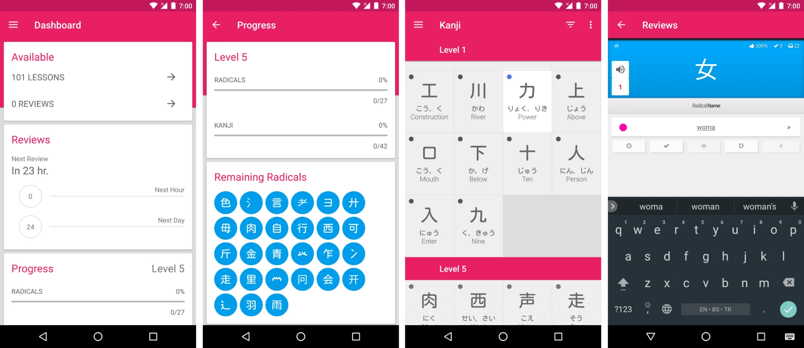

# UI inspiration

Saved 2026-11-01 for `/architect ui foundation` (feature 4, spec 0003) and the screen specs after it. Take the **layout, flow, and colorway**. The colorway is allowed by the owner's choice (2026-11-01, `AGENTS.md` ground rule 2).

## Take these ideas

- **Dashboard as stacked cards**: "Available" (lesson count and review count, each a row with an arrow), "Reviews" (next review time, then counts for the next hour and next day), and "Progress" (current level with a bar per subject type). Maps to the dashboard (0008).
- **Level progress page**: one card per subject type with a label, a percent, a thin progress bar, and a passed/total count, then a grid of what is still locked. Maps to items and levels (0009).
- **Subject grid**: a tiled grid grouped under a level header. Each tile shows the characters large, the reading in kana, and the meaning, with a small dot for the SRS stage. Maps to 0009.
- **Review screen**: a big prompt band with the character in the middle, the question type as a label under it ("Radical Name"), one answer field, and a row of small action buttons under the field (audio, info, undo). The stats strip (accuracy, done, remaining) sits in the corner of the prompt band. Maps to the core loop (0004).
- Phone first, with one column of cards and generous tap targets.
- **The colorway**: pink `#e91e63` for the app bar, headings, and kanji; blue `#009dec` for radicals and the review prompt band; purple `#aa00ff` for vocabulary. The tokens are in spec 0003.

## Do not take

- The WaniKani name, logo, stage names, icons, or any content shown in the screenshots. Use our stage names (Seed, Sprout, Bloom, Harvest, Retired).
- The Material Design app bar look as is. Our UI foundation sets its own shell.
